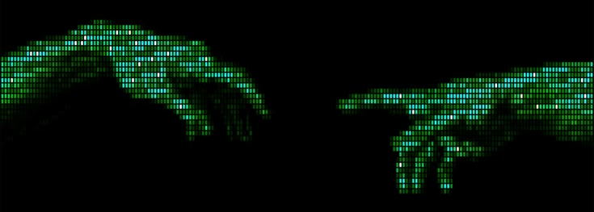

<!-- Banner -->
<p align="center">
  
</p>

<p align="center">
  
</p>

<p align="center">
  
</p>

---

## 🎯 About me

```python
class ObrouEva:
    role      = "Maths & Computer Science undergrad @ Université Lyon 1"
    goal      = "Cybersecurity & Cloud Architect"

    building  = [
        "homelab: Proxmox · Linux · networking · hardening",
        "Python tools for security & automation",
    ]

    learning  = [
        "Linux administration & Bash",
        "Networking fundamentals",
        "Security hardening",
        "Cloud & Infrastructure as Code (next)",
    ]

    principle = "Verify, then trust."
```

---

## 🔭 Featured project

<table>
  <tr>
    <td width="60%">
      <h3><a href="https://github.com/ObrouEva/homelab">🧪 homelab</a></h3>
      A self-hosted lab on a Dell OptiPlex Micro running <b>Proxmox VE</b>, documented week by week:
      what I built, the commands, what broke and how I fixed it.<br/><br/>
      <b>Done:</b> bare-metal install · ISO integrity check · repo & kernel updates<br/>
      <b>Next:</b> Debian VMs · SSH hardening · firewalls · segmentation · SIEM · AWS
    </td>
    <td width="40%" align="center">
      <br/>
      
    </td>
  </tr>
</table>

---

## 🛠️ Tech arsenal

<table>
  <tr>
    <td align="center" width="50%">
      <h4>💻 Languages</h4>
      
    </td>
    <td align="center" width="50%">
      <h4>🖥️ Systems & Infra</h4>
      
      
    </td>
  </tr>
  <tr>
    <td align="center">
      <h4>🧰 Tools & Workflow</h4>
      
    </td>
    <td align="center">
      <h4>📚 Learning next</h4>
      
      
    </td>
  </tr>
</table>

---

## 📊 GitHub analytics

<p align="center">
  
</p>

<p align="center">
  
</p>

---

<p align="center"><i>"Learning in public, mistakes and fixes included."</i></p>

<p align="center">
  
</p>
